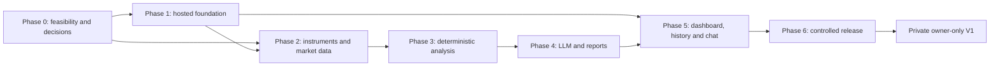

# Implementation Plan — AI-Assisted Indian Equity Market Analysis Platform

- **Status:** Planning baseline; no application implementation is authorized by this document.
- **Source of truth:** [EDD v0.2](EDD-v0.2.md). The EDD remains authoritative if this plan and the EDD differ.
- **Scope:** Private, hosted, single-owner V1 for NSE/BSE equities; synchronous analysis; one provider and one LLM initially; Python modular monolith; no order execution, schedules, queue, microservices, LangGraph or Google ADK.
- **Planning rule:** A phase can start only when its entry conditions are met. A later phase cannot silently waive an earlier provider, licensing, security or legal gate.

## 1. How to use this plan

This plan decomposes EDD §§18–20 into work packages and observable acceptance checks. Acceptance checks are planned verification, not tests already run. Phase 0 is a feasibility and decision phase, with market-data provider selection and candle-snapshot rights as its highest-priority gates.

The implementation team should keep a small decision log and link each task to its EDD requirement and, when relevant, the ADR that records the decision. Record a deferred or failed gate explicitly; do not quietly narrow or broaden the product in code.

## 2. Execution principles and dependency order

1. **Establish feasibility and rights first.** Do not build a production market-data adapter or enable snapshot persistence until the selected plan and contract permit the required use.
2. **Keep one deployable application.** Use a strongly typed Python modular monolith, a plain typed pipeline, PostgreSQL, and private object storage only if the approved snapshot design needs it.
3. **Make data eligibility a hard pipeline boundary.** Data-quality, entitlement, adjustment, calendar, freshness, or sufficiency failures stop before an LLM call.
4. **Keep analytical facts separate.** Deterministic calculations produce evidence and candidate levels; one LLM call interprets those inputs; deterministic code enforces direction eligibility and plan geometry.
5. **Keep the initial scope narrow.** One provider, one LLM, the EDD's small indicator set, owner-only access, report-scoped chat, and synchronous request/response.
6. **Do not imply unearned certainty.** No scalar setup score, uncalibrated probability, guaranteed fill, or portfolio risk sizing without the required inputs and method.
7. **Require owner approval before application implementation.** This plan is the deliverable for the current phase. Wait for explicit approval before scaffolding or writing application code.

The frontend shell and non-provider foundation tasks may proceed after their own Phase 0 decisions, but production data ingestion and Tier B snapshots remain blocked until the provider/rights gate passes.

## 3. Phase 0 — Feasibility, provider rights, and design decisions

**Purpose:** Turn the EDD's open provider, licensing, retention, hosting, security, direction-policy and workload questions into evidence-backed decisions before production integration.

**Entry conditions:** EDD v0.2 and the owner's private, hosted, single-owner V1 boundary are accepted as the planning baseline.

### Work packages

| ID | Task and dependency | Deliverable | Acceptance evidence |
|---|---|---|---|
| P0.1 | Confirm the initial release posture and its non-goals. Depends on none. Record single-owner access, no public registration/sharing, no orders, no schedules, no derivatives, no scalar setup score, and the distinction between V1 and future distribution. | Scope decision record linked from ADRs or project decision log. | Scope checklist matches EDD §§1–2, 14 and 19; no unresolved requirement silently changes the V1 audience or output surface. Any wider-access launch remains explicitly gated on qualified India-specific advice. |
| P0.2 | Build a market-data candidate matrix for two or three plausible providers, including previously discussed candidates only if their current official material supports evaluation. Depends on P0.1. | Candidate matrix with date, official API/product docs, plan and account prerequisites, API version, authentication, exchanges, actual interval/lookback limits, volume/OI semantics, request caps, pricing, and known exclusions. | Every factual cell links to current official provider docs or is labeled **unverified**. No free tier, data entitlement, BSE support, retention right, or reliability claim is inferred from a third-party article or an API endpoint existing. |
| P0.3 | Verify the provider's binding data-use terms before choosing a provider. Depends on P0.2. | Provider rights matrix and retained copy/link of the applicable agreement, plan terms, and any written provider clarification. | The matrix separately answers retrieval, processing, private display, chart display, derived evidence, storage duration, object-store/backups, LLM/subprocessor processing, account/user scope, deletion, audit, termination, and post-termination retention. Ambiguity is treated as **not verified**, not permission. |
| P0.4 | Run a bounded, non-production provider spike against the requested instrument/timeframe/lookback matrix. Use authorized credentials and no persistent raw/snapshot storage before P0.3 is resolved. Depends on P0.2; P0.3 controls what may be retained or sent to external services. | Spike report with redacted request/response examples where allowed, tested instruments and dates, timing, errors, and data-quality findings. | Fetches work with the intended account; results are checked for timestamp convention, start/end boundaries, partial bars, pagination/truncation, duplicates/gaps, OHLC invariants, missing-versus-zero volume, corporate-action behavior, historical depth, and session alignment. The report includes at least one corporate-action-affected window. No raw vendor payload is committed unless its terms explicitly allow it. |
| P0.5 | Decide whether one candidate satisfies the product's chart and reproducibility requirement. Depends on P0.3–P0.4. | Pass/fail decision for Tier B normalized candle snapshots and a proposed TTL, storage format, backup treatment, deletion process, and policy identifier. | Explicit contract language or provider confirmation supports each required storage/display/backup/deletion use. If no provider passes, stop provider integration and request an owner decision on provider choice or the EDD's snapshot/chart requirement; do not silently weaken either. |
| P0.6 | Finalize the canonical candle, instrument identity, market calendar, adjustment, and closed-candle contract. Depends on observations from P0.4 and official exchange/calendar sources. | ADR-002 plus canonical examples for NSE and BSE; source/version policy for calendars and instrument mappings. | Examples define UTC bar start/end, provider timestamp mapping, `as_of`, exchange-local session date, complete/partial status, volume units/status, adjustment basis, corporate-action as-of, effective-dated listing/provider keys, auctions/special sessions, and aggregation boundaries. Two reviewers can map the same source sample to the same canonical representation. |
| P0.7 | Decide hosted vendor/region, single-owner identity model, secret handling, database/object storage, backups, deletion, and operational ownership. Depends on P0.1, P0.3 and owner cost/data-residency constraints. | ADR-004 and ADR-007; private hosted threat model and monthly cost envelope. | A named deployment option supports TLS, private managed persistence, secret management, backups/restore, access logs and deletion. Owner-only authorization is enforceable server-side. Provider secrets and user/model data are not exposed to the browser. |
| P0.8 | Verify the chosen LLM provider's data retention, training, regional processing and deletion terms, and estimate cost/latency for bounded report context. Depends on P0.1 and candidate evidence package shape. | LLM provider decision record and model call budget. | Terms are linked to the applicable account tier; only the structured evidence needed for one report is proposed for transmission. No prompt or user report is sent to an unapproved service. |
| P0.9 | Define direction × segment × horizon policy, especially cash-equity SHORT. Depends on legal/provider/broker capability review and EDD §10. | ADR-005 with explicit `ACTIONABLE`, `BIAS_ONLY`, or `UNSUPPORTED` cases and source/effective date. | Every V1-supported combination has an evidence-backed basis and test cases. Unverified combinations return bias-only/WAIT or are rejected; bearish analysis is never equated with permission to short. |
| P0.10 | Set synchronous request, provider and model timeout budgets and workload caps from provider-spike measurements. Depends on P0.4 and P0.8. | ADR-006 with request deadline, per-stage timeouts, retry policy, max intervals/lookback, bounded concurrency, idempotency expiry, and cost limit. | A documented budget fits within selected hosting/proxy limits with a safety margin; errors and partial-data policy are defined. No queue or background continuation is introduced to hide timeout behavior. |
| P0.11 | Finalize initial indicator subset and quantitative reference definitions using actual provider semantics. Depends on P0.4 and P0.6. | Indicator catalogue v1: OHLCV evidence, SMA/EMA, RSI, ATR; explicit decision on any additions. | Formula/reference, warm-up, seed, missing-data behavior, units, timeframe, lookahead behavior, and deterministic fixtures are specified. Any indicator that depends on unsupported/ambiguous volume or adjustment semantics is deferred. |

### Provider feasibility protocol

The spike must test the exact usage that V1 needs, not just whether an API returns a successful response:

1. Select two or three liquid NSE/BSE listings and a historical window that includes a corporate action. Confirm listing/provider-key mapping and entitlement.
2. Request the candidate V1 intervals and maximum intended lookbacks. Record limits, API version, rate-limit behavior, auth lifecycle, pagination and response errors.
3. Compare provider timestamps with official exchange session/calendar rules; inspect opening/closing and special-session cases where data is available.
4. Compare sample candles and adjustments against a trusted source or independently verified chart data, documenting limits of that comparison.
5. Obtain clear permission for normalized snapshots, chart display, storage TTL, backup, third-party processing, deletion and contract termination. Treat silence or ambiguous terms as unresolved.
6. Produce an ADR recommendation with total cost, account eligibility, data quality, operations burden, terms, unsupported requirements, and a go/no-go decision. Do not declare a provider “best” based only on price or interval names.

Official references to begin research—not evidence of entitlement—include [Upstox Historical Candle V3](https://upstox.com/developer/api-documentation/v3/get-historical-candle-data/), its [rate-limit documentation](https://upstox.com/developer/api-documentation/rate-limiting/), [Angel One SmartAPI documentation](https://smartapi.angelone.in/docs), NSE's [Data Sharing & Usage Policy](https://www.nseindia.com/static/market-data/nse-data-policy), and SEBI's [retail algorithmic-trading circular](https://www.sebi.gov.in/legal/circulars/feb-2025/safer-participation-of-retail-investors-in-algorithmic-trading_91614.html). Upstox labels its older [V2 historical candle endpoint deprecated](https://upstox.com/developer/api-documentation/get-historical-candle-data/); candidate evaluation must verify the currently supported endpoint and applicable product version at the time of the spike. API documentation is not proof of an account entitlement or a license to retain, display, redistribute, or send market data to a subprocessor. Applicable account terms and agreements take precedence over generic endpoint documentation. Links were checked on 2026-11-07 and must be rechecked during Phase 0; their inclusion does not pre-judge whether any rules apply to this read-only product. TejHQ or another candidate must be evaluated from its current official material; no capability or right is assumed here.

### Phase 0 acceptance tests / exit criteria

- **P0-AT1 — Rights gate:** an authorized reviewer can point to current binding terms or written confirmation for every Tier B storage/display/backup/deletion use, or the feature is explicitly disabled pending an owner decision.
- **P0-AT2 — Capability gate:** a provider passes the actual instrument × interval × lookback request matrix with documented data-quality and failure behavior.
- **P0-AT3 — Canonical contract gate:** sample data from the candidate adapter can be represented unambiguously under the selected candle, listing, calendar, adjustment and completeness rules.
- **P0-AT4 — Security gate:** private owner-only identity, secrets, storage, backup and restore architecture has an approved threat model; public access remains disabled.
- **P0-AT5 — Direction gate:** supported LONG/SHORT actions are enumerated; unknown rules do not produce actionable plans.
- **P0-AT6 — Cost/latency gate:** selected provider and LLM fit a documented synchronous request and spending budget.
- **P0-AT7 — ADR gate:** ADR-001 through ADR-007 are accepted, or each unresolved item has a named owner, explicit blocked work, and a follow-up date/decision trigger.

**Definition of done:** Phase 0 ends with a provider selected only if the rights and capability gates pass; canonical data and policy decisions recorded; hosted owner-only threat model accepted; and explicit hold points for unresolved legal/data terms. If no candidate passes the snapshot-rights gate, Phase 0 is blocked for provider-backed implementation until the owner resolves the product/rights conflict. Synthetic-data foundation work may proceed only if the owner separately approves beginning implementation.

## 4. Phase 1 — Hosted foundation

**Purpose:** Establish the secure, minimal deployment and project tooling for the owner-only hosted application, without implementing market-analysis behavior.

**Dependencies:** P0.1 and P0.7 accepted. Production credentials, provider integration and Tier B storage remain disabled unless their Phase 0 gates passed.

| ID | Task | Dependencies | Deliverable | Acceptance tests |
|---|---|---|---|---|
| P1.1 | Define the Python modular-monolith package boundaries and typed API/error conventions; set up the supported Python version, `uv`, formatting, linting, typing, dependency pinning and CI. | P0.1, P0.7 | Reproducible backend project baseline and CI configuration. | Fresh environment can install locked dependencies; formatting/lint/type checks and a trivial health check run in CI; no analysis/domain logic is introduced. |
| P1.2 | Create FastAPI application shell, health/readiness endpoints, request IDs, central typed errors, secure headers and request-size/time limits. | P1.1, P0.10 | Minimal API shell. | Health endpoints disclose no secrets; protected routes reject anonymous requests; malformed/oversized input is bounded; request ID appears in structured logs and response metadata. |
| P1.3 | Configure hosted ingress, TLS, private application/database/storage networking, and deployment configuration. | P0.7 | Repeatable private deployment configuration and deployment notes. | HTTPS is enforced; database and object storage are not publicly reachable; deployment supports health checks, graceful shutdown and controlled restart. |
| P1.4 | Implement owner authentication/session and service/repository-level ownership checks; keep public registration and sharing disabled. | P0.7, P1.2 | Owner-only authentication boundary. | Acceptance tests cover unauthenticated access, expired/rotated sessions, CSRF protections as applicable, and attempts to access another owner's synthetic report/profile/snapshot. |
| P1.5 | Provision PostgreSQL, schema migrations, private object storage (only if selected), secret references, encryption and backup/restore configuration. | P0.5, P0.7, P1.3 | Persistence baseline and restore runbook. | Migration applies from an empty database; snapshots are private; test restore produces readable synthetic records; secrets are absent from DB/logs; deletion/TTL mechanism is exercised on synthetic objects. |
| P1.6 | Configure structured logs, essential metrics, authentication/rate/cost controls, alert routing and secret/dependency scanning. | P0.7, P0.8, P1.2 | Operational baseline. | Synthetic auth failure, provider failure, model spend threshold and deletion failure are observable; secrets and sensitive prompts are redacted in captured logs. |
| P1.7 | Add a minimal React/TypeScript shell and same-origin/session integration if required by the chosen hosting model. | P0.7, P1.3 | Non-functional frontend shell. | Owner can authenticate and reach a placeholder dashboard; no secrets are present in client bundles or browser storage. |

**Definition of done:** A private hosted shell is deployable, owner-authenticated and observable; database/storage, migrations, backup and restore behavior are documented and checked. No market-data or LLM call is enabled by this phase.

## 5. Phase 2 — Instrument and market-data foundation

**Purpose:** Resolve instruments and return canonical, quality-checked candles from the single selected provider, persisting snapshots only under the approved rights policy.

**Dependencies:** P0-AT1 through P0-AT3 pass; P1.1–P1.6 done. A non-retaining adapter mode is allowed only if the owner accepts the EDD's corresponding loss of replay/chart behavior.

| ID | Task | Dependencies | Deliverable | Acceptance tests |
|---|---|---|---|---|
| P2.1 | Implement canonical security, listing, alias, effective-dated provider mapping, tick-size and instrument status models. | P0.6, P1.5 | Instrument domain and repository. | Symbol changes and duplicate symbols resolve to the correct historical listing; unknown, suspended and delisted mappings produce typed outcomes; owner scoping is enforced. |
| P2.2 | Import/refresh the selected provider's instrument master and document its provenance, update cadence and reconciliation behavior. | P0.2, P0.3, P2.1 | Instrument-master ingestion/refresh procedure and versioned records. | A known test set maps to provider keys; stale or malformed master input fails visibly; symbol aliases do not overwrite historical mappings. |
| P2.3 | Implement the provider protocol, capability preflight, one provider adapter, per-credential rate limiter, bounded pagination and typed errors. | P0.2–P0.4, P1.6, P2.1 | One production adapter behind a narrow protocol. | Contract tests cover valid response, no data, unsupported range, invalid instrument, expired auth, throttling, timeout, malformed response and provider outage; no retries occur for permanent errors. |
| P2.4 | Implement canonical candle normalization and quality checks for timezone, bar boundaries, OHLC, ordering, duplicates, gaps, completeness, volume, adjustments and session alignment. | P0.4, P0.6, P2.3 | Versioned normalizer/validator and quality summary. | Fixture tests cover half-open intervals, session open/close, holidays/special sessions, partial bars, missing-vs-zero volume, truncation, duplicate/out-of-order records, invalid OHLC and inconsistent adjustment bases. |
| P2.5 | Implement exchange calendar and session source/version handling for NSE and BSE, including exceptional/special sessions. | P0.6, P2.4 | Calendar adapter/cache with recorded version per run. | Historical and current fixture dates align to approved exchange calendars; if calendar is stale/unavailable, analysis fails or is degraded by explicit policy rather than assuming a normal weekday. |
| P2.6 | Persist immutable Tier B normalized candle snapshots in private object storage and Tier A provenance metadata, with TTL, rights policy ID, checksum, access audit and deletion. | P0.5, P1.5, P2.4 | Snapshot writer/reader, retention job/operation, provenance model. | Snapshot checksum matches canonical serialized data; only authorized owner reads it; expiry removes the object and records outcome; backup/deletion behavior matches approved terms; provider without snapshot rights is prevented from writing one. |
| P2.7 | Add a non-retaining policy path if the selected provider's rights require it. | P0.5, P2.3–P2.4 | Explicit provider policy enforcing no Tier B snapshot. | Tests prove no normalized candle payload enters object storage, caches, logs or unauthorized LLM context in non-retaining mode; API/UI disclose the replay limitation. |

**Definition of done:** Provider requests are capability/entitlement-checked; canonical data is validated with source semantics preserved; snapshot writing is contract-gated, owner-scoped and deletable; failure modes are explicit. No analysis LLM call exists yet.

## 6. Phase 3 — Deterministic quantitative engine

**Purpose:** Generate reproducible evidence and candidate price levels from validated snapshots without an LLM.

**Dependencies:** Phase 2 done; input snapshots/fixtures and their reuse are permitted; P0.11 indicator catalogue accepted.

| ID | Task | Dependencies | Deliverable | Acceptance tests |
|---|---|---|---|---|
| P3.1 | Define versioned typed evidence contracts with source timestamps, timeframe, evidence IDs, quality flags and indicator metadata. | P0.6, P0.11, P2.4 | Evidence schema and versioning rules. | Schema rejects missing units, invalid timestamps and untraceable evidence; serialization is stable for hashing; each finding links to its input snapshot/window. |
| P3.2 | Implement OHLCV summaries, SMA/EMA, RSI and ATR with explicit formula, seed, warm-up and missing-value behavior. | P0.11, P3.1 | Small deterministic indicator package. | Golden fixtures cover warm-up, flat prices, gaps, zero/missing volume where relevant, NaN handling, and known reference values; repeated calculation on the same versioned snapshot is identical within documented numerical tolerance. |
| P3.3 | Implement multi-timeframe alignment and evidence synthesis without arbitrary indicator voting. | P2.4, P3.1–P3.2 | Per-timeframe and cross-timeframe evidence summaries. | Tests preserve conflicts, align only observations available by `as_of`, exclude future/incomplete higher-timeframe observations, and never fill missing intervals with invented data. |
| P3.4 | Implement versioned named gate checklist and gate explanations. | P0.9, P0.11, P3.1–P3.3 | `PASS`/`FAIL`/`UNKNOWN` gate evaluation. | Mandatory failed/unknown data, eligibility, warm-up or risk gates prevent actionability; reasons cite evidence/policy IDs; no aggregate score/probability field exists. |
| P3.5 | Generate deterministic candidate levels and calculate price-distance/R:R geometry with tick-size and zone conventions. | P0.9, P3.1–P3.4 | Candidate-level catalogue and risk geometry outputs. | Long/short geometry, zero distance, multi-price entry zones, tick alignment, target ordering and unsupported short policy are covered; results do not claim fills, loss budgets or portfolio sizing. |
| P3.6 | Persist engine, indicator, calendar, adjustment and gate versions with evidence. | P1.5, P2.6, P3.1 | Versioned evidence persistence. | Replaying a retained permitted snapshot under the same version yields the same typed evidence/hash; if inputs are non-retained, auditability fields still identify limitations. |

**Definition of done:** Deterministic evidence, named gates and candidate levels can be generated from fixture/snapshot input with no LLM. Lookahead, session-boundary, corporate-action and determinism checks pass; scope remains within the small EDD indicator set.

## 7. Phase 4 — LLM interpretation, validation, and reports

**Purpose:** Add one evidence-grounded model call and persist a typed, validated report without allowing model output to override policy or data quality.

**Dependencies:** Phase 3 done; P0.8 LLM terms and model budget accepted; P0.9 direction policy and P0.10 synchronous budgets accepted.

| ID | Task | Dependencies | Deliverable | Acceptance tests |
|---|---|---|---|---|
| P4.1 | Define provider-neutral reasoning interface, one LLM adapter, configuration/version metadata and outbound data minimization. | P0.8, P1.6, P3.1 | One model adapter and typed invocation record. | Mocked contract tests cover success, timeout, quota, malformed output and provider outage; payload excludes raw candles unless separately permitted and required. |
| P4.2 | Build prompts from typed evidence, named gates and candidate-level/evidence IDs; add prompt-injection boundaries and bounded schema repair. | P3.1–P3.5, P4.1 | Versioned prompt and output schema. | Model can only select supplied evidence/candidate IDs; unknown IDs, unbounded output, unsupported actionability or invented numeric fields fail validation; repair attempts respect request budget. |
| P4.3 | Implement final policy/risk validator and explicit outcome (`ACCEPTED`, `DOWNGRADED`, `REJECTED`) with diffs/findings. | P0.9, P3.4–P3.5, P4.2 | Deterministic validation result and report assembly. | Invalid/stale data short-circuits before LLM; unsupported direction yields bias-only/WAIT/NO_TRADE; bad geometry or missing provenance cannot become an actionable plan; every downgrade is recorded. |
| P4.4 | Implement synchronous `CreateAnalysis` pipeline with idempotency, deadlines, typed errors, transaction boundaries and stage timings. | P0.10, P1.2, P1.5, P2.3–P2.6, P3.1–P3.5, P4.1–P4.3 | End-to-end application service and synchronous API endpoint. | Duplicate `Idempotency-Key` requests do not create duplicate paid model calls; timeout does not continue in background; no DB transaction spans a network call; partial/failed timeframe policy is honored. |
| P4.5 | Persist immutable request/config, evidence, permitted snapshot reference, prompt/model metadata, raw structured response, validator outcome and report versions. | P1.5, P2.6, P3.6, P4.1–P4.4 | Report persistence and retrieval service. | Report reconstructs what inputs/policies were used; owner-only access tests pass; retention/deletion covers report, prompts and linked snapshots under their approved policies. |
| P4.6 | Create a versioned model evaluation set and baseline. | P3.1–P3.5, P4.2–P4.5 | Fixed-case evaluation report with qualitative grounding and schema metrics. | Cases include contradictory evidence, insufficient data, stale/incomplete data, unsupported short, WAIT/NO_TRADE, invalid levels and chat/report mismatch; model changes require regression comparison. No outcome probability claim is made. |

**Definition of done:** A synchronous request yields a completed typed report or bounded typed error; invalid or ineligible cases fail safely; stored provenance and permitted snapshots are owner-scoped; one model's output is constrained by evidence IDs and deterministic validation.

## 8. Phase 5 — Dashboard, history, charts, and report-scoped chat

**Purpose:** Deliver the owner workflow over the shared application services and report evidence.

**Dependencies:** Phase 1 authentication/frontend shell and Phase 4 report API done. Charting requires P0.5 snapshot rights and Phase 2 snapshot support.

| ID | Task | Dependencies | Deliverable | Acceptance tests |
|---|---|---|---|---|
| P5.1 | Build the supported instrument/timeframe/indicator/preferences form from backend capability/catalog APIs. | P2.1–P2.3, P3.2, P4.4 | Analysis dashboard form. | Unsupported intervals/options cannot be submitted; form defaults match server validation; user cannot set unapproved model providers, score thresholds or arbitrary risk sizing. |
| P5.2 | Render reports with timestamps, source, freshness, adjustment basis, quality warnings, directional bias, actionability, verdict, gates, conflicts, plan assumptions and validator findings. | P4.3–P4.5 | Report view. | UI distinguishes computed values from narrative and bullish/bearish bias from actionable LONG/SHORT; WAIT/NO_TRADE and blocked reasons remain visible. |
| P5.3 | Add chart/history views tied to exact report snapshot IDs and retention status. | P0.5, P2.6, P4.5 | Owner-scoped history and chart replay. | Chart data equals the report's retained snapshot; expired/non-retained snapshots show unavailable status; no silent provider refetch replaces historical inputs. |
| P5.4 | Implement report-scoped follow-up chat using the same application services. | P4.1–P4.5 | Chat interface and endpoint. | Every answer references one report ID/as-of; context does not mix current and historical facts; chat cannot trigger new analysis implicitly, expose another owner's data, or take any order action. |
| P5.5 | Add settings for provider/model status and retention/account information without revealing secrets. | P1.4, P1.6, P4.1, P2.6 | Safe operator settings view. | Credentials are never returned to browser; capability/retention state matches server policy; settings routes are owner-protected. |

**Definition of done:** The owner can configure a supported analysis, run it synchronously, review its provenance and result, revisit a permitted chart snapshot, and ask a grounded follow-up about that exact report.

## 9. Phase 6 — Hardening and controlled private release

**Purpose:** Verify the complete V1 against EDD acceptance criteria, operations and data/secret lifecycle before enabling the private owner deployment.

**Dependencies:** Phases 1–5 complete; all blocking ADRs accepted; no unresolved provider rights or security release gate.

| ID | Task | Deliverable | Acceptance tests |
|---|---|---|---|
| P6.1 | Run security and authorization review; scan dependencies/secrets; verify TLS, cookies/session, CORS, CSRF/XSS defenses, least-privilege secret access and owner scoping. | Security findings and remediation record. | No unresolved critical/high release issue; cross-owner access, anonymous access and credential disclosure tests fail safely. |
| P6.2 | Exercise provider/model/database/object-store failure modes, limits, retries, idempotency, concurrency and graceful shutdown. | Failure-mode results and operational thresholds. | No retry storm; request budget is bounded; provider/model outages produce typed errors; duplicate calls are prevented as designed; shutdown does not silently lose/persist partial results incorrectly. |
| P6.3 | Verify snapshot TTL, report retention, account deletion, backup expiry, deletion audit and provider contract termination procedures. | Retention/deletion runbook and evidence. | Synthetic end-to-end lifecycle demonstrates permitted data is deleted from primary storage and handled correctly in backups/logs; failures alert and are auditable. |
| P6.4 | Test database and object backup restoration and secret rotation/revocation. | Restore and credential incident runbooks. | Restore reproduces the intended private service state without exposing credentials; rotated/revoked secrets stop being usable; recovery is documented. |
| P6.5 | Review latency/cost dashboards, per-user limits, provider quotas, storage growth and alert thresholds. | Cost/latency baseline and operational budget. | p50/p95 and failure metrics are captured; alerts fire on synthetic thresholds; owner approves budget caps. |
| P6.6 | Reconcile implementation with EDD §19 and produce a known-limitations/release record. | Private release checklist and traceable acceptance matrix. | Every EDD V1 criterion is mapped to evidence; no public registration, sharing, scheduled analysis or order execution is enabled; unresolved wider-distribution gate is explicit. |

**Definition of done:** EDD §19 acceptance criteria pass for private single-owner V1; provider and LLM terms are recorded; restore/deletion/cost/security controls are verified; wider access remains disabled until separate review and approval.

## 10. Cross-phase blockers and unresolved decisions

| Decision/blocker | EDD reference | Blocks | Required resolution |
|---|---|---|---|
| Provider, plan, account eligibility, current cost, intervals, lookback, quality and rate limits | §§2.3–2.5, 7, 18 Phase 0, 20 Q1 | Production market-data integration and Phase 2 | Pass the measured candidate matrix and record current official docs/account evidence in ADR-001. |
| Rights to retrieve, process, chart, retain, back up, send to subprocessors, delete and retain after termination | §§1, 7.6, 11, 18, 19.12, 20 Q4 | Tier B snapshots and potentially provider selection | Written terms/confirmation for each use; otherwise disable snapshot feature and obtain explicit owner decision whether to reject provider or revise EDD product requirement. |
| Hosting vendor/region, managed services, budget, identity and restore ownership | §§14, 16, 18, 20 Q2 | Hosted foundation and release | Approve ADR-004/007 and private owner-only threat model. |
| Initial audience; legal/regulatory limits for trade-like outputs | §§1.3, 14.5, 18, 20 Q12 | Any access beyond private owner-only posture or marketing | Keep public/invited access disabled until qualified advice and contracts are reviewed; document applicable constraints. |
| LONG/SHORT eligibility by instrument/segment/horizon, especially cash-equity intraday short | §§4.6, 10, 18 Phase 4, 20 Q5 | Actionable-plan behavior | Approved, versioned ADR-005; unknown case is bias-only or unsupported. |
| NSE/BSE calendars, special sessions, corporate-action adjustment semantics | §§7.3.1–7.5, 20 Q6–Q7 | Intraday/adjusted historical calculations | Name official source/version and behavior in ADR-002; fail closed/degrade explicitly when unknown. |
| LLM provider/model retention, region, training and deletion; cost/latency | §§9, 14.3, 18, 20 Q9 | Phase 4 external call | Verify current account terms and approve minimum structured context in ADR-008 or add to provider/hosting ADRs. |
| Snapshot TTL, report/chat/prompt/log/backups retention periods | §§11.2–11.3, 14.3, 20 Q4/Q11 | Tier B persistence and hosted release | Set per-data-class lifecycle from provider/privacy requirements; deletion is testable. |
| Synchronous deadline, workload caps, idempotency semantics | §§5.3, 12.1, 20 Q10 | Phase 4 API | Measure after spike and approve ADR-006; no worker/queue substitution without owner approval. |
| Backtesting versus paper trading next | §§15.4, 20 Q13 | Post-V1 validation only | Defer; do not expand V1 scope. Decide separately when V1 evidence and requirements justify it. |

### Required decision records

EDD requires ADR-001 through ADR-007. Add an ADR for the LLM vendor/data-handling choice if it is not cleanly covered by ADR-001 or ADR-007. Each ADR should contain: decision status, context, alternatives, official/current sources, entitlement or account assumptions, chosen option, consequences, owner, date, revisit trigger and impacted EDD sections.

## 11. Phase dependencies and parallel work

- Phase 0 is the critical path for any provider-backed work. Rights and data-quality findings are gates, not paperwork that can be completed after integration.
- Phase 1 identity/hosting and a synthetic-data API shell can run in parallel with P0 provider evaluation only after the owner approves starting implementation; no provider credentials or production market data are needed for that work.
- Phase 2 instrument mapping, calendars and provider integration depend on the canonical contract; snapshot persistence additionally depends on explicit Tier B rights.
- Phase 3 depends on Phase 2 canonical fixtures. Indicator work may use synthetic fixtures while access is pending, but acceptance against provider data is blocked until P0 passes.
- Phase 4 depends on tested evidence, LLM terms and direction policy; no model call should happen for invalid/ineligible data.
- Phase 5 report/chart work can start against contract fixtures after Phase 4 schema stabilizes; chart replay is rights-gated.
- Phase 6 is a release gate, not an optional cleanup sprint.

## 12. Out of scope and change control

Do not add live order execution, scheduled analysis, streaming alerts, portfolio management, derivatives, public registration, multi-user sharing, multi-agent workflows, LangGraph, Google ADK, microservices, message brokers, Kubernetes, caches or backtesting to V1 unless a new requirement is approved and its data/security/operational implications are documented. No task in this plan authorizes application code before the owner approves the implementation phase.

If a Phase 0 finding conflicts with an EDD-confirmed decision—especially provider snapshot retention versus provider rights—stop the affected work and request an explicit owner decision. Update the EDD/ADR before implementing a changed product promise.
