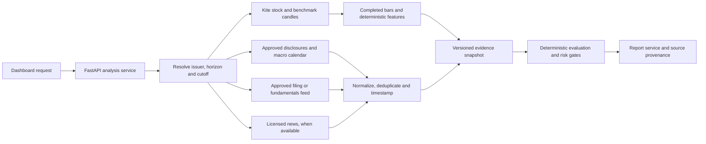
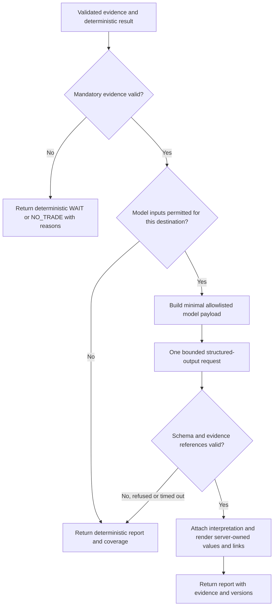

# Evidence sources and LLM integration for Indian equity research

Research snapshot · 25 November 2026

Architecture baseline · [EDD v0.3](EDD-v0.3.md) · [Implementation plan](IMPLEMENTATION_PLAN.md)

## Decision

The backend fetches, timestamps, normalizes, and validates the evidence. It sends a bounded, structured snapshot to the LLM, which explains the setup, identifies conflicting evidence, and describes what could invalidate the interpretation. The evaluation module owns the verdict, candidate levels and hard gates. The model receives a single snapshot per report, with no browsing, remote tools or trading access in the first release.

Start with technical evidence, domestic market and sector context from Kite, and scheduled-event risk from primary sources. Treat financial results as useful swing context and a source of event risk for intraday reports. Add a licensed news feed only after measuring whether its coverage and latency improve these reports. Keep market regime, news tone and company fundamentals as distinct inputs. A rising sector index says something about relative performance and nothing by itself about the tone of news coverage.

Letting the LLM choose sources would make retrieval and interpretation vary together. With backend-owned retrieval, a report can be replayed against the same snapshot, missing coverage is observable, and the team can measure each data source independently. If users later need open-ended research, add bounded read-only retrieval for follow-up questions and record each item before it can enter the report.

## Data sources

| Source | What it can provide | Integration decision and remaining checks |
| --- | --- | --- |
| [Kite historical candles](https://kite.trade/docs/connect/v3/historical/) and [quote/instrument endpoints](https://kite.trade/docs/connect/v3/market-quotes/) | Stock, domestic benchmark and sector returns, volatility context from India VIX | First market-context adapter. Use timestamped and aligned historical bars. Confirm entitlement, exchange-use terms and whether derived values may be sent to an external model. Quotes can display snapshots separately. |
| [Official NSE MCP](https://www.nseindia.in/nse-mcp), [launch notice](https://nsearchives.nseindia.com/web/pressrelease/2026-11/PR_cc_08112026_20261108152949.pdf) | Advertises end-of-day history, breadth and near-real-time equity tools with a stated one-to-three-minute delay | Candidate for a separate informational breadth test. NSE limits this MCP to informational, noncommercial use. Check permitted integration, retention, availability and actual data timestamps. Evaluate server-side with fixed tool calls if adopted. |
| [NSE RSS](https://www.nseindia.in/static/rss-feed), [SEBI filing directory](https://www.sebi.gov.in/curation/corporate_filings.html), [Infosys investor relations](https://www.infosys.com/investors/reports-filings/quarterly-results.html) | Exchange announcements, board meetings, results, corporate actions and issuer materials | Use RSS to discover events and official releases to verify facts. Pilot with a small universe and authorized links/metadata. Verify completeness, publication timestamps, polling and retention rights. Use a filing or approved structured feed for financial values. |
| [NSE corporate data](https://www.nseindia.in/static/market-data/corporate-data-subscription) and [BSE information products](https://www.bseindia.com/downloads1/Information_Products_Pricing_Sheet.pdf) | Exchange-supplied corporate announcements and financial results | Procurement options if disclosure coverage becomes critical. NSE describes leased-line delivery for its corporate product. Confirm current plans, delivery format, revisions and rights before committing to either. |
| [Trendlyne MCP](https://help.trendlyne.com/support/solutions/articles/84000399411-what-capabilities-are-currently-available-in-the-trendlyne-mcp-server-) and [EODHD Fundamentals](https://eodhd.com/financial-apis/stock-etfs-fundamental-data-feeds) | Trendlyne documents Indian issuer resolution, financial parameters, news and document search. EODHD documents a fundamentals REST API | Trial Trendlyne first for Indian coverage and EODHD as a REST comparison. Require sample NSE/BSE responses, issuer matching, consolidated figures, disclosure timestamps, correction history, latency, pricing and permission for model processing. [EODHD notes endpoint coverage varies](https://eodhd.com/financial-apis/quick-start-with-our-financial-data-apis). |
| [RBI RSS](https://rbi.org.in/Scripts/rss.aspx), [Fed RSS](https://www.federalreserve.gov/feeds/feeds.htm) and [FOMC calendar](https://www.federalreserve.gov/monetarypolicy/fomccalendars.htm) | Scheduled policy events and official India/US announcements | Add a small calendar first. Keep publication and scheduled time separate. Global price series, USD/INR and oil are subsequent sector-dependent inputs and need their own feed and session validation. |
| [GDELT DOC](https://blog.gdeltproject.org/announcing-the-gdelt-full-text-search-api/) and [LSEG Machine Readable News](https://www.lseg.com/en/data-catalogue/news) | GDELT can discover relevant headlines across languages. LSEG advertises structured news and entity-level analytics | Use GDELT in a discovery trial. Check issuer disambiguation, latency, duplicate stories and recall against curated events. For production news, request a licensed LSEG/Reuters trial and verify Indian issuer coverage and rights for excerpts, derived sentiment, external inference and caching. Discovery links confer no rights to article bodies. |

### Direct checks

- Kite returned all three requested benchmark quotes through the existing Python adapter for `NSE:NIFTY 50`, `NSE:NIFTY IT`, and `NSE:INDIA VIX`. All three quote feed timestamps were epoch values. A seven-day 15-minute candle request returned 100 bars for each, with the same latest returned bar start, 23 November at 15:15 IST. This was a single off-session observation on 25 November IST. It verifies entitlement and index symbol resolution for the current session, with regular-session freshness and expected-bar cadence still to be checked. Apply the existing completed-bar policy and compare actual stock and benchmark timestamps before using a value.
- The local stock quote route returned HTTP 422 for `NSE:NIFTY 50` because public symbol validation rejects spaces. Keep stock search and technical routes equity-specific. Add an internal, allowlisted benchmark path through the existing provider.
- Official pages confirm the advertised feeds and interfaces. This research measured neither paid-vendor latency nor NSE RSS/MCP completeness. Confirm the polling and permitted use of actual feeds before enabling scheduled ingestion.

## Can the LLM fetch the three inputs?

Yes. With function calling, the LLM can request data and the backend can execute the corresponding read-only adapter. With a web search tool, it can also discover public sources. A system prompt can specify source preferences, how to search, and when to report uncertainty. Strict schemas constrain function arguments and report shape. The backend still needs to verify identity, timing, coverage and permissions before using an item. For example, a correctly formatted response can cite an old earnings release, or omit a material filing entirely. [Function calling](https://developers.openai.com/api/docs/guides/function-calling) · [Agent safety](https://developers.openai.com/api/docs/guides/agent-builder-safety)

| Input | Where model-directed retrieval helps | Main downside and proposed boundary |
| --- | --- | --- |
| Market and sector performance | The model could request context for an unfamiliar sector or a second comparison window. | Kite access still needs an adapter. A plausible result can mix sessions or intervals, miss a bar, or use a stale quote. The backend always fetches required benchmarks, aligns completed bars, and calculates returns and VIX changes. |
| Company and macro catalysts | The model can search alternate issuer names, follow useful leads, and suggest relevant filings or policy releases when the first query is sparse. | Search can surface old stories, duplicate disclosures, or the wrong issuer. It can also miss a mandatory event. The backend checks official feeds and calendars on every applicable report and validates any additional candidate against the primary source and cutoff. |
| Broader news and market breadth | The model can adapt searches to new industry themes, global developments, and follow-up questions. | Search rankings, coverage and publication lag vary. Syndicated copies can exaggerate the apparent weight of a story. Use a licensed feed and deduplicate news before it enters the report. Use a fixed provider query for breadth, which is a numeric market measure tied to a universe and session. |

Model-directed retrieval can broaden coverage without writing rules for every news topic or issuer alias. It adds model/tool turns, variable cost and latency, and another source of variation between runs. Even a strong prompt cannot verify that search found every material event. Retrieved text can also contain instructions that affect the model's next action. The same observed evidence can be replayed if source records are retained under their terms. The original search results may change.

If we pilot this, expose a single supplementary discovery tool backed by approved sources. The server sets the instrument, dates, allowed providers and permissions, then enforces call and time limits. Each returned candidate must resolve to a source record with matching entity or market scope, publication time at or before the cutoff, and allowed usage. Deduplicate candidates against the base snapshot and treat retrieved text as data. Record failed or skipped searches as incomplete coverage. Compare the pilot with backend-only retrieval on missed material events, irrelevant or duplicate hits, repeatability and total report latency and cost. Keep structured backend retrieval for the first release. The best initial use for model-directed retrieval is discovering optional news for follow-up questions.

## What to supply by trading horizon

| Evidence | Intraday | Swing, up to two weeks |
| --- | --- | --- |
| Technicals | Completed 15-minute and hourly candles. Trend, momentum, ATR, relative volume and prior range | Completed daily and hourly candles. Multi-session range, ATR and volume |
| Market and sector | Stock return minus benchmark return over common bar endpoints, stock versus its sector, and India VIX level and change | Comparable returns over matching sessions and persistence of relative strength. Add market breadth when a reliable entitled feed is available |
| Catalysts | Material announcements since prior close and upcoming releases before market close | Most recent material announcements and earnings, policy events or corporate actions inside the proposed holding window |
| Fundamentals | Last results or guidance when the release is a current catalyst | Latest filed consolidated revenue growth, operating margin change and guidance changes when available. Add cash flow or leverage only when relevant to the sector and the thesis |
| Tradeability | Gap versus confirmed prior close, traded value and, if fresh and licensed, bid-ask spread | Average traded value, abnormal gaps and corporate-action checks before comparing past prices |

Compute relative performance as the percentage-point difference between returns over identical start and end timestamps. Missing paired bars produce unavailable context. Use an exchange calendar and explicit sessions, including market holidays and overseas session boundaries. Treat India VIX as an implied volatility measure for the market, not a direction signal. Distinguish vendor sentiment scores from labels inferred from headline text, and preserve the coverage interval for both. Silence in a feed counts as no relevant item only when retrieval succeeded and the reported coverage spans the requested window.

A catalyst carries an issuer identifier, event category, disclosure URL, published time, scheduled time if applicable, and revision if known. Match by exchange-qualified listing and ISIN where available. Avoid counting the same NSE and BSE disclosures or syndicated copies twice. Store the original published timestamp and when the adapter first observed it. For results also preserve quarter, reporting basis, currency, scale, original publication and the revision chain. Compare like periods and like reporting bases. For banks or other sectors with incompatible metrics, omit generic comparisons or use a separately defined metric. Earnings proximity belongs in the risk section even if no financial statement values are available.

## Evidence assembly and timing



Choose one analysis cutoff in the backend. Keep source publication, first observation, period end, scheduled time and retrieval time independent. Require a known-at timestamp at or before cutoff for published material. In historical replay use archived observations or documented point-in-time vendor records, excluding revisions that arrived later. Future event times are eligible if the schedule itself was known at cutoff. A newly retrieved quote can never establish the time of its underlying price observation. Missing scheduled bars, wrong sessions and stale observations need explicit coverage flags; timestamp alignment alone does not establish completeness.

Use separate bounded deadlines for market and optional source calls and reuse an in-flight fetch for shared benchmarks. Cache catalysts and fundamentals by issuer and version where allowed, refreshing on new disclosures. Keep intraday freshness tied to the latest eligible bar rather than an arbitrary database age. Cache the exchange calendar, sector mapping and static identifiers independently.

## Model contract and report flow



- **Model input envelope.** Include schema version, instrument, horizon, cutoff, coverage by category and the deterministic result. Every evidence item has a stable ID, kind, typed value and unit, source record reference and timing. Each category reports `available`, `empty`, `stale`, `unavailable` or `not_permitted`. Include only allowlisted derived metrics and approved event metadata or short source excerpts. Credential material, account/portfolio data, raw candles and unapproved text stay outside the request. Preserve original titles and links on the server for attribution.
- **Model output envelope.** A short summary, supporting observations, conflicts, invalidation conditions and limitations. Each substantive item references one or more supplied IDs. Candidate levels and numerical facts appear in the UI through server-owned fields keyed by ID. Constrain interpretation enums and lengths. Validate evidence IDs, reference types, polarity where deterministically known and required missing-data disclosures. A valid ID alone does not verify free-text meaning. Reject new prices, targets, URLs and unsupported claims, and measure residual semantic errors through human review. The published verdict and levels come from evaluation.
- **Provider choice.** Start with a provider-neutral report boundary and one synchronous adapter. The OpenAI Responses API is a candidate because it accepts a Pydantic-backed structured output schema, with refusal and incomplete states handled explicitly. Pick a pinned model after comparing grounding, latency and cost on the same fixtures. Set `store=false` where supported and review provider terms and account settings. OpenAI documents separate abuse monitoring and application state retention. [Structured Outputs](https://developers.openai.com/api/docs/guides/structured-outputs) · [Data controls](https://developers.openai.com/api/docs/guides/your-data)
- **Handling external evidence.** Treat headline and filing text as untrusted input, bounded and delimited as data. All reads stay within preconfigured adapters. Validate URLs against approved source domains before showing them, render model text as text, and log identifiers, hashes, counts and latency in place of raw prompts. Record the model snapshot, prompt, schema and evaluation versions. An external destination needs explicit entitlement for the source and intended use, including derived metrics, retention and any downstream redistribution. [Zerodha terms](https://zerodha.com/terms-and-conditions) · [NSE data policy](https://betanseapi.nseindia.com/static/market-data/nse-data-policy) · [SEBI circular on real-time data sharing](https://www.sebi.gov.in/legal/circulars/may-2024/norms-for-sharing-of-real-time-price-data-to-third-parties_83572.html)
- **Error and cost handling.** Return evidence with an explicit interpretation status when the LLM fails or a source is unavailable. Cap the request by input size, output tokens and deadline. Start with one model call and disable automatic retries. Deduplicate in-flight requests by owner, evidence hash, and model/prompt version. Cancellation and timeouts bound local work; a remote provider may already have started processing a timed-out request.

### Example request and response

An illustrative excerpt for an intraday report is shown below. Evidence values in this example are fixtures.

```json
{
  "schema_version": 1,
  "instrument": "NSE:INFY",
  "horizon": "intraday",
  "cutoff": "2026-11-23T10:02:00+05:30",
  "coverage": {"technicals": "available", "market": "available", "news": "unavailable"},
  "evidence": [
    {"id": "tech.rsi", "kind": "rsi", "value": "56.2", "unit": "index"},
    {"id": "market.stock_vs_sector", "kind": "relative_return", "value": "-0.4", "unit": "percentage_points"}
  ],
  "evaluation": {"verdict": "WAIT", "reason_codes": ["sector_underperformance"]}
}
```

```json
{
  "observations": [
    {
      "kind": "conflict",
      "text": "Momentum has improved, while the stock is lagging its sector.",
      "evidence_ids": ["tech.rsi", "market.stock_vs_sector"]
    }
  ],
  "limitations": ["news"]
}
```

In this example a single RSI reading cannot establish improvement. The validator should reject that claim if using a controlled assertion such as `momentum_improving`, and human evaluation must catch the same error in free text. An accepted explanation could state that RSI is above its midpoint while the stock is lagging the sector.

## Delivery and evaluation

1. **Define the report boundary and deterministic prerequisites.** Reuse `technical_evidence` and completed-bar selection. Add the typed snapshot/coverage and deterministic verdict contracts under the existing evaluation stage. Use a fixture-backed interpreter for contract tests while actual provider and data permissions are reviewed.
2. **Add Kite benchmark and event adapters.** Start with Nifty 50, India VIX and a small explicit sector mapping such as Infosys to Nifty IT. Test multiple sectors, in-session and after close, timestamps, partial responses, holidays and one corporate-action case. Verify a small official event set against exchange disclosures and issuer releases. Keep missing sources visible.
3. **Run a model pilot.** Exercise a local report endpoint with an approved input projection and the chosen model, with caps and deterministic fallback. Compare technical-only against technical plus market/catalyst context. Then test whether fundamentals or news add value. Use point-in-time cases for conflicting signals, flat/illiquid names, earnings gaps, absent/stale evidence, late corrections, duplicate news, instruction-bearing headlines, refusals and fabricated evidence references.
4. **Measure before rollout.** Require zero deterministic-gate overrides and zero unknown citations in accepted output. Repeat each evaluation case to measure stability of evidence selection and interpretation. Review claim support, missed material events, publication lag, coverage, usefulness, p50/p95 latency and cost per accepted report. Choose thresholds for usefulness, latency and cost from the pilot. Keep the replayable fixture suite in the repository for model and prompt upgrades. Evaluate future predictive performance separately from report quality, with point-in-time evidence and trading costs.
